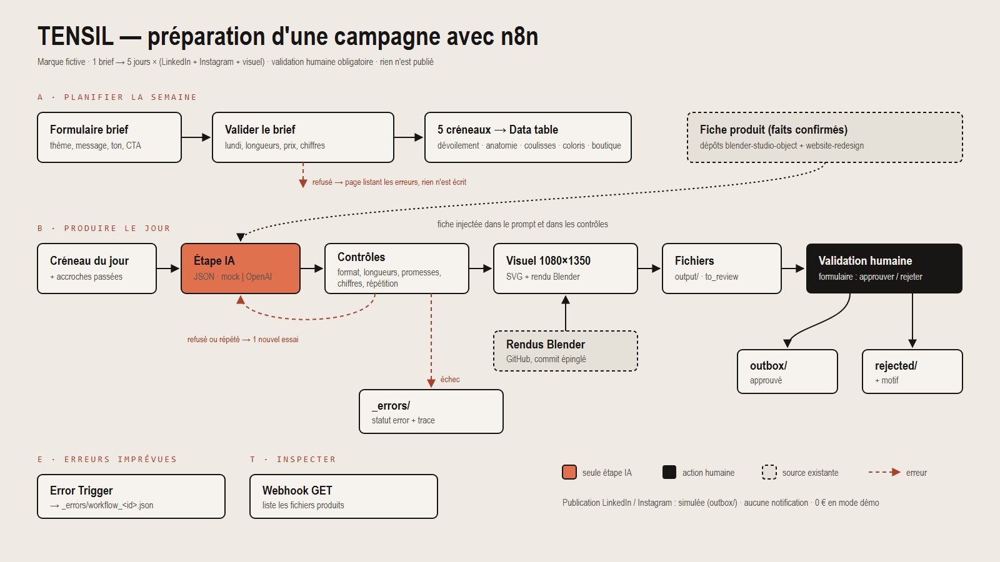

# TENSIL — préparation d'une campagne de lancement avec n8n

> Projet de démonstration pour portfolio. **TENSIL est une marque fictive** : la lampe n'est pas commercialisée, et aucune publication n'est diffusée. Les contenus sont préparés, contrôlés et validés, puis rangés dans une boîte d'envoi simulée.

Un brief de campagne devient, sur 5 jours ouvrés, un post LinkedIn, un post Instagram et un visuel 1080×1350 par jour. Chaque contenu est contrôlé automatiquement, puis **validé par un humain** avant d'être classé.

TENSIL est la lampe de bureau articulée présentée dans deux autres projets du portfolio. Ce dépôt en réutilise les faits et les images, sans les modifier :
- [blender-studio-object](https://github.com/elie-gordo/blender-studio-object) : modèle 3D et rendus Blender ;
- [website-redesign](https://github.com/elie-gordo/website-redesign) : boutique de démonstration ([tensil-store.vercel.app](https://tensil-store.vercel.app)).

Le teaser vidéo de TENSIL est un projet distinct : ce workflow prépare des posts, il ne produit pas de film.




## Le problème
Lancer un produit demande de publier régulièrement, avec un message distinct chaque jour, adapté à chaque plateforme et fidèle au produit. Une IA rédige vite, mais elle invente facilement des caractéristiques, des prix ou des promesses. Ici, la marque n'a même rien à vendre : toute promesse commerciale serait fausse.

## Comment un brief devient des contenus

| Étape | Workflow | Ce qui se passe |
|---|---|---|
| 1. Brief | `TENSIL — A · Planifier la semaine` (formulaire n8n) | thème, message clé, coloris, ton, appel à l'action. Le brief est refusé s'il n'est pas daté d'un lundi, s'il est trop court ou trop long, s'il contient un prix ou une promesse de vente, ou un chiffre absent de la fiche produit. |
| 2. Plan | A | 5 créneaux dans la Data table `tensil_slots`, un angle par jour (ci-dessous). Une semaine déjà planifiée est refusée. |
| 3. Rédaction | `TENSIL — B · Produire le jour` (8 h en semaine, désactivé par défaut, ou webhook de démo) | **seule étape IA** : un JSON avec l'accroche, le texte LinkedIn, la légende Instagram, les hashtags et les textes du visuel. |
| 4. Contrôles | B | voir « Contrôles automatiques ». Un échec déclenche **un** nouvel essai avec le motif, puis l'erreur. |
| 5. Visuel | B | SVG 1080×1350 dans la direction artistique de la boutique, avec le **rendu Blender** de l'angle, lu sur GitHub à un commit fixé. |
| 6. Validation | B (formulaire d'attente n8n) | un humain approuve ou rejette avec un motif. |
| 7. Classement | B | `outbox/` (approuvé), `rejected/` (motif), `_errors/` (échec). Rien n'est envoyé à LinkedIn ni à Instagram. |
| Imprévus | `TENSIL — E · Erreurs` | toute exception non gérée écrit une trace dans `_errors/`. |
| Inspection | `TENSIL — T · Inspecter les sorties` | un webhook GET liste les fichiers produits, en lecture seule. |

### Les 5 angles de la semaine
| Jour | Angle | Message | Rendu utilisé (blender-studio-object) |
|---|---|---|---|
| Lun | Dévoilement | la lampe entière, le principe des ressorts équilibreurs | `renders/web/01_hero.webp` |
| Mar | Anatomie | un chiffre de la fiche : 2 ressorts par segment, base de 22 cm… | `renders/web/03_detail.webp` |
| Mer | Coulisses | construite par scripts Python dans Blender, image de synthèse | `renders/web/wire_hero.webp` |
| Jeu | Coloris | Graphite, Sauge, Oxyde ou Crème ? (question à la communauté) | `renders/web/colorways_test.webp` |
| Ven | La boutique | vue 3D à 360°, coloris en direct, commande simulée | `renders/web/04_lit.webp` |

## Où intervient l'IA
Une seule étape : la rédaction (nœud `OpenAI : générer`, sortie au format JSON imposé). Le prompt contient une **fiche produit** limitée aux faits confirmés par les deux dépôts : dimensions, matériaux représentés, coloris, origine des images, boutique de démonstration. Tout le reste est déterministe : planification, contrôles, mise en page du visuel, classement, statuts.

## Contrôles automatiques
| Contrôle | Règle | Si échec |
|---|---|---|
| Format | JSON valide, champs présents | nouvel essai, puis `error` |
| Longueurs | accroche ≤ 90, LinkedIn 100–1300, Instagram 50–600, titre du visuel ≤ 40 (≤ 14 avec un chiffre pour l'anatomie), 3 à 8 hashtags `#MotSansEspace` | nouvel essai, puis `error` |
| Promesses interdites | prix, vente, disponibilité, livraison, caractéristique non documentée (LED, watts…), garantie, « fait main », écologie, superlatifs, confort visuel | nouvel essai, puis `error` |
| Chiffres | chaque nombre écrit doit figurer dans la fiche produit (les décimales comptent comme un seul nombre) | nouvel essai, puis `error` |
| Répétition | accroche comparée aux précédentes (similarité de Jaccard ≥ 0,6) | nouvel essai, puis `needs_review` |
| Rendu | le rendu Blender doit être lu et intégré | `needs_review`, visuel sans image |

Les listes de promesses et de chiffres sont des garde-fous **non exhaustifs** : la validation humaine reste obligatoire.

## Fichiers produits
Dans `~/.n8n-files/tensil/` côté n8n. Les noms sont à plat (semaine, jour, angle), car le nœud d'écriture de n8n ne crée pas de dossiers.
```
output/   2026-W43_1-lun_devoilement_{linkedin.md, instagram_caption.md, instagram_1080x1350.svg, meta.json}
outbox/   post approuvé + visuel + _decision.json
rejected/ post rejeté + _decision.json (motif)
_errors/  2026-W43_3-mer_<exécution>.json · workflow_<exécution>.json (workflow E)
```
`meta.json` contient le brief, l'angle, le statut, les contrôles de chaque essai, la provenance du rendu (dépôt, commit, chemin) et `published: false`. `decision.json` contient la décision, le motif et la date. Chaque fichier `.md` se termine par la mention « marque fictive · jamais publié ».

**Exemples réels** (produits sur l'instance, liens de validation masqués) dans [examples/](examples/) :
- lundi approuvé → `outbox/` ;
- mardi : promesse « 249 € » refusée au 1er essai, corrigée au 2e (voir `checks` dans le `meta.json`) ;
- mercredi : réponse invalide deux fois → `_errors/` ;
- jeudi : accroche répétée → `needs_review` ;
- vendredi : rejeté avec motif → `rejected/` ;
- plus la trace du workflow E, et le post « coulisses » produit le mercredi suivant (`2026-W44_3-mer_coulisses_*`).

## Lancer la démo

Prérequis : n8n **2.x** auto-hébergé (testé sur 2.43.6) avec Data tables, Python 3.11+, et Node.js pour les tests hors ligne.

1. **Dossiers de sortie** (n8n 2.x n'écrit que sous `~/.n8n-files` et ne crée pas les dossiers) :
   ```bash
   docker exec -u node <conteneur-n8n> mkdir -p /home/node/.n8n-files/tensil/output /home/node/.n8n-files/tensil/outbox /home/node/.n8n-files/tensil/rejected /home/node/.n8n-files/tensil/_errors
   ```
   Pour conserver les fichiers après une mise à jour du conteneur, montez un volume sur `/home/node/.n8n-files`.
2. **Déploiement par l'API** (recommandé) : copier `.env.example` en `.env`, le remplir, puis
   ```bash
   set -a; . ./.env; set +a
   python scripts/build_workflows.py --deploy
   ```
   Le script crée la table `tensil_slots` et les 4 workflows, les publie (E compris : n8n 2.x ne déclenche pas un workflow d'erreur non publié) et règle E comme workflow d'erreur de A, B et T.
3. **Ou import manuel** des 4 fichiers de [workflows/](workflows/) : créer la table `tensil_slots` (colonnes de `COLUMNS` dans [scripts/build_workflows.py](scripts/build_workflows.py), toutes en `string` sauf `day_index` en `number`), remplacer `REPLACE_WITH_tensil_slots_TABLE_ID` dans chaque nœud Data table, définir `TENSIL — E · Erreurs` comme workflow d'erreur de A, B et T, puis publier les 4 workflows.
4. **URL publique** : `N8N_EDITOR_BASE_URL` et `WEBHOOK_URL` (ou `N8N_WEBHOOK_URL`) doivent pointer vers l'adresse réellement utilisée, sinon les liens de formulaire renvoient vers `localhost`.
5. **Accès sortant** : B lit les rendus sur `api.github.com` (dépôt public, sans jeton, 60 requêtes par heure et par IP).

### Utilisation
- **Brief** : `https://<n8n>/form/tensil-brief`
- **Produire un jour à date forcée** :
  ```bash
  curl -X POST https://<n8n>/webhook/tensil-produire -H "Content-Type: application/json" \
       -d '{"date":"2026-10-19","mock_case":"valid"}'
  ```
  `mock_case` : `valid`, `claim` (promesse au 1er essai), `invalid_once`, `invalid_json`, `repeat`.
- **Valider** : le lien du formulaire est dans `tensil_slots.review_url` et dans `*_meta.json`.
- **Voir les fichiers** : `https://<n8n>/webhook/tensil-inspect`

## Simulé ou réel
| | Mode `mock` (par défaut) | Mode `live` |
|---|---|---|
| Rédaction | réponses simulées écrites à partir de la fiche produit | API OpenAI (`gpt-4o-mini`) via une credential n8n |
| Coût | 0 € | ≈ 0,0005 $ par appel ([docs/COSTS.md](docs/COSTS.md)) |

Le mode simulé démontre l'orchestration, les contrôles, la validation et les erreurs. Il ne démontre **pas** la qualité rédactionnelle d'un modèle. La publication sur LinkedIn et Instagram est simulée dans tous les cas.

## Vérifications
- `node scripts/offline_tests.mjs` exécute le JavaScript réel des nœuds Code sans n8n : **57/57**.
- `python scripts/e2e_tests.py` joue 12 scénarios sur une instance réelle, en mode simulé : **23/23** (n8n 2.43.6, 2026-10-16).

Détail des scénarios : [docs/VERIFICATION.md](docs/VERIFICATION.md).

## Limites
- Aucune publication réelle : il faudrait des comptes professionnels, une application déclarée et des autorisations d'API.
- Visuels en SVG avec le rendu WebP intégré. Instagram attend du JPEG ou du PNG : une conversion serait nécessaire avant une vraie publication. Les polices sont appelées par leur nom, sans être embarquées, donc le rendu dépend de la machine.
- Le formulaire de validation montre les textes, pas le visuel : celui-ci se consulte dans `output/` ou via le workflow T.
- Les garde-fous (promesses, chiffres) reposent sur des listes : une reformulation peut passer. L'anti-répétition ne détecte pas les reformulations sémantiques.
- Les rendus dépendent de GitHub au moment de la production. S'ils sont indisponibles, le post passe en `needs_review`.
- Le lien de validation n'est envoyé nulle part : il faut le récupérer dans la table ou dans `meta.json`.
- Licence n8n : *Sustainable Use License*, source disponible mais **pas open source** ([docs/CREDITS.md](docs/CREDITS.md)).

## Sécurité
- Aucun identifiant ni secret dans le dépôt ou dans les exports. La clé n8n reste dans `.env` (ignoré par git), la clé OpenAI dans une credential n8n.
- Les webhooks de démo n'ont pas d'authentification : l'instance de test n'est joignable que par réseau privé (Tailscale). Sur une instance publique, ajoutez une authentification par en-tête aux webhooks B et T.

## Documentation
- [Brief](docs/BRIEF.md) · [Architecture](docs/ARCHITECTURE.md) · [Vérifications](docs/VERIFICATION.md)
- [Coûts](docs/COSTS.md) · [Crédits & licences](docs/CREDITS.md) · [Contenu portfolio](docs/PORTFOLIO.md)
